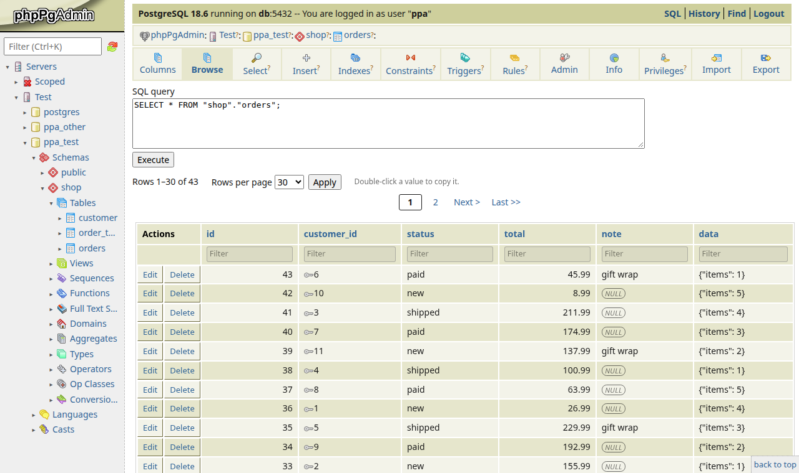
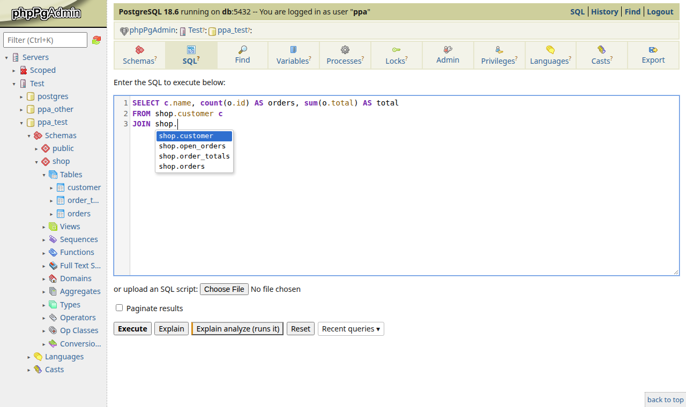
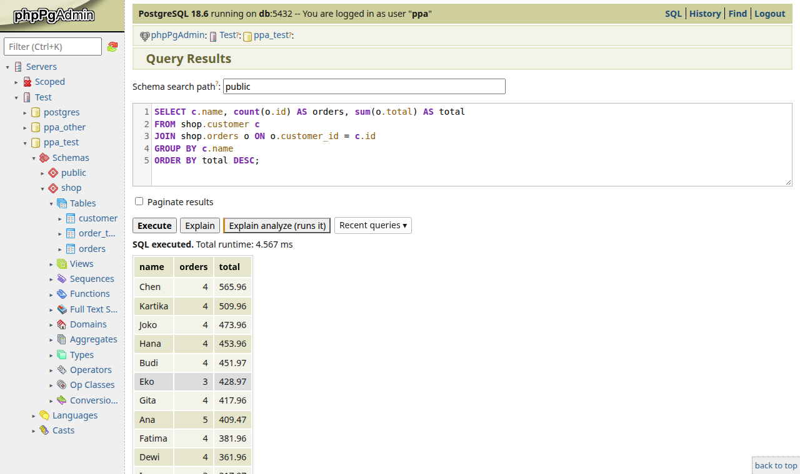
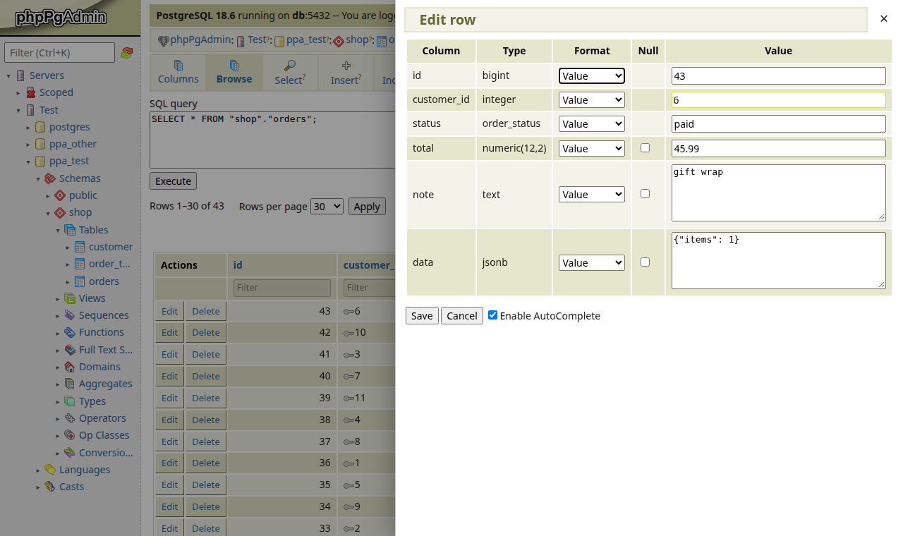
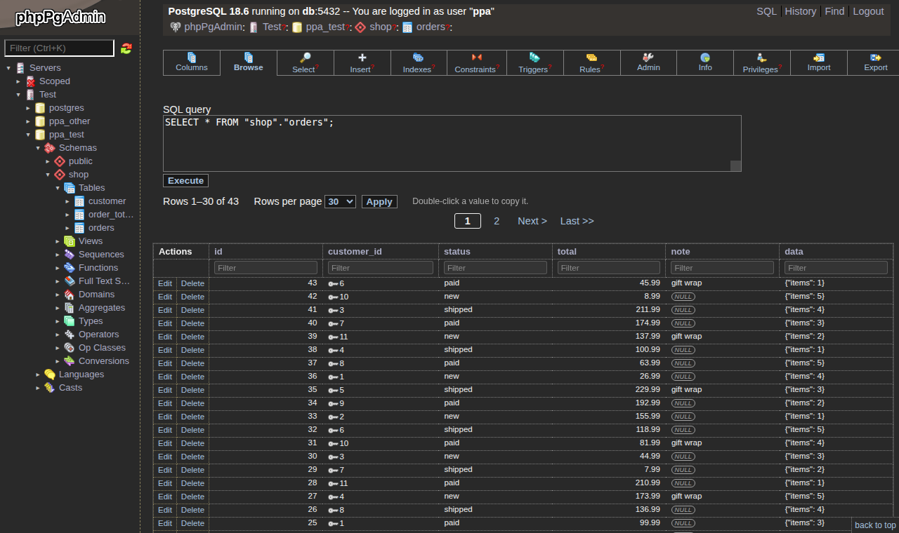
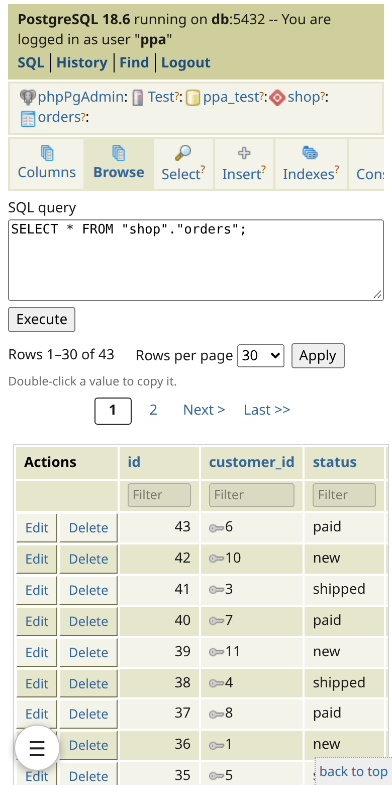
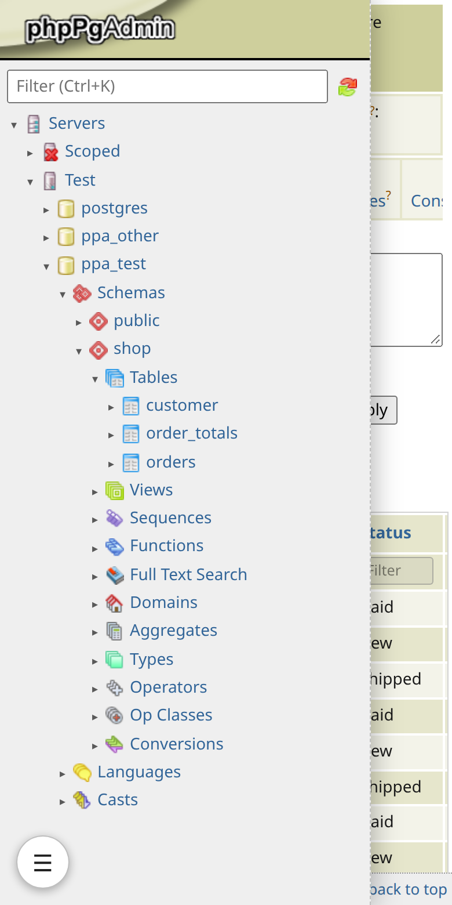

# phpPgAdmin

A web UI for managing PostgreSQL, written in PHP.

The original project at [phppgadmin/phppgadmin](https://github.com/phppgadmin/phppgadmin)
stopped getting releases in 2020. [ReimuHakurei/phpPgAdmin](https://github.com/ReimuHakurei/phpPgAdmin)
kept it alive with PHP 8 fixes, and this repo builds on that. What's added here:

- a Docker image that runs on current PHP and ships a current `pg_dump`
- a test setup that logs in and clicks through the whole UI against several
  PostgreSQL versions, and fails on any PHP warning or SQL error
- GitHub Actions that run those tests and push the image to Docker Hub when a
  release is published
- a few fixes for things that broke on newer PostgreSQL (see `HISTORY`)
- a reworked UI: one page instead of frames, a SQL editor, faster browsing of
  big tables (see below)

## Screenshots



<table>
  <tr>
    <td width="50%"><br><sub>SQL editor: suggestions while typing</sub></td>
    <td width="50%"><br><sub>Results under the editor</sub></td>
  </tr>
  <tr>
    <td width="50%"><br><sub>Editing a row in a side panel</sub></td>
    <td width="50%"><br><sub>Dark theme</sub></td>
  </tr>
</table>

<p>
  
  &nbsp;
  
</p>

## Using it

- Every page has its own address, so bookmarks, reloads, new tabs and the
  back button work. Pages load in place; the object tree on the left keeps
  its state.
- **Ctrl+K** jumps to the tree filter. Type part of a name, **Enter** opens the
  first match among the branches you've opened; with no match there, Enter
  (or the link under the tree) searches the whole current database. The tree
  opens itself down to the page you're on. It can be resized by dragging its
  edge (double-click resets it); on a phone it slides in from the ☰ button.
- In the SQL editor, **Ctrl+Enter** (Cmd+Enter on a Mac) runs the query, or
  only the selected text if there is a selection. Keywords, schemas, tables and
  columns are suggested as you type (and after `schema.` or `table.`).
  Picking a schema lists its tables; tables outside the search path are
  offered by their bare name and inserted as `schema.table`. **Ctrl+Space**
  shows suggestions any time. "Explain analyze" really runs the statement.
  "Recent queries" and the History page show the same list: the last 50
  queries run on the database in this session. "Show results in the data
  grid" gives pages, sorting and filters; unticked, up to 1000 rows come back
  as a plain table. The box remembers how you left it.
- When browsing a table, the row above the data filters each column
  (`=value` for an exact match), and the page size can be changed. Big tables
  show an estimated row count ("about 1.2M rows") instead of counting every
  row; there's a link to count exactly. Without a chosen order, the newest
  rows (by primary key) come first. Double-click a cell to copy its full
  value. Edit opens the row in a panel next to the grid, Delete asks in a
  small dialog; either way you stay on the same page, filters and scroll
  position. Tables without a primary key or unique column can't be edited
  here. Drop/empty confirmations elsewhere open as dialogs too.
  Ctrl/Cmd+click opens the full page instead.
- In lists, rows with many actions show the first two and a "⋯" menu with the
  rest; actions that destroy something (Drop, Empty, Delete) come last, in
  red. The page's own actions (Create table, Add column...) are buttons above
  the list. Ticking rows brings up a bar with what can be done to all of them.
  Rarely used tabs (Rules, Operators, Op Classes, Conversions, Aggregates,
  Languages, Casts) are under "More".
- The tables list shows each table's size, and counts the rows of small
  tables that were never analyzed instead of showing "—". A column's
  constraints read "PK", "FK → customer.id", "Unique" or "Check: ...".
- When inserting a row, fields left empty get the column's default (or NULL)
  instead of an empty string that numbers, dates and JSON reject; a text
  column that can't be NULL gets the empty string. When editing, an empty
  number, date or JSON field is saved as NULL, an empty text field as an
  empty string. Enum columns offer their values in a list, dates and times
  get the browser's date and time inputs.
- A query that fails in the data grid reports the error against the query as
  typed, and marks the spot in the editor.
- A failed login says why (wrong password, server unreachable, pg_hba.conf,
  SSL) and shows the server's own message, and keeps the username. Logging
  in from a link opens the page the link was for.

## Running it

With local accounts (the app keeps its own users; for a sign-in proxy see
[Signing in](#signing-in)):

```sh
openssl rand -base64 32 > vault_key
docker run -d --name phppgadmin -p 8080:8080 \
  -e PPA_SERVERS="db.example.internal:5432" \
  -e AUTH_MODE=local -e AUTH_ADMIN_GROUP=admin \
  -e VAULT_KEY_FILE=/run/secrets/vault_key \
  -v "$PWD/vault_key:/run/secrets/vault_key:ro" \
  -v phppgadmin-data:/data \
  syamsf/phppgadmin
docker exec -it phppgadmin php bin/vault user:add --admin alice
```

The last command asks for alice's password. Then open http://localhost:8080
and sign in.

With Compose, next to an existing database:

```yaml
services:
  phppgadmin:
    image: syamsf/phppgadmin
    ports:
      - "127.0.0.1:8080:8080"
    environment:
      PPA_SERVERS: "Main=postgres:5432"
      AUTH_MODE: local
      AUTH_ADMIN_GROUP: admin
      VAULT_KEY_FILE: /run/secrets/vault_key
    secrets:
      - vault_key
    volumes:
      - phppgadmin-data:/data
    depends_on:
      - postgres

secrets:
  vault_key:
    file: ./vault_key   # openssl rand -base64 32 > vault_key

volumes:
  phppgadmin-data:
```

and the first admin with
`docker compose exec phppgadmin php bin/vault user:add --admin alice`.

### One login per database

If each database on a server has its own user, list the databases after a `/`,
separated by `+`:

```sh
-e PPA_SERVERS="Shop=db1.internal:5432/orders+billing, Temp=db2.internal/scratch"
```

Each database then shows up under its server in the sidebar. Clicking one asks
for that database's username and password, and the login is checked against
that database (not `postgres`), so a user that can only connect there gets in.
A per-database login only sees its own database: the server-wide pages
(database list, roles, tablespaces, full export) aren't available with it.
Servers without a `/` part keep a single login for the whole server.

A per-database login is a restriction of this web interface, not of
PostgreSQL. The user can still connect to any database that `pg_hba.conf` and
the database's `CONNECT` privilege allow, with any other client. For real
isolation use `pg_hba.conf` rules, or `REVOKE CONNECT ON DATABASE other FROM
PUBLIC` and grant it only to the roles that need it.

By default you can't log in as `postgres` (or `root`, `pgsql`, `administrator`)
or with an empty password. Create a normal login role for yourself, or set
`PPA_EXTRA_LOGIN_SECURITY=false` if you really want the old behaviour.

### Settings

| Variable | Default | |
|---|---|---|
| `PPA_SERVERS` | `localhost` | Servers shown on the login page, separated by commas or spaces. Each one is `host`, `host:port` or `Name=host:port`, optionally followed by `/db1+db2` for a login per database (see above) or `?sslmode=require` to set the sslmode of just that server. IPv6 goes in brackets: `[::1]:5432`. Names can't contain spaces. |
| `PPA_SSLMODE` | `prefer` | `disable`, `allow`, `prefer`, `require`, `verify-ca` or `verify-full`. Applies to every server that has no `?sslmode=` of its own. Use `verify-full` for anything that crosses a network you don't control. |
| `PPA_SSLROOTCERT` | | Path (inside the container) of the CA certificate file used by `verify-ca` and `verify-full`. Mount it into the container. |
| `PPA_DEFAULTDB` | `postgres` | Database to connect to before you pick one. |
| `PPA_EXTRA_LOGIN_SECURITY` | `true` | Block superuser names and empty passwords on the login page. |
| `PPA_OWNED_ONLY` | `false` | Only list databases the user owns. This only hides them in the list. |
| `PPA_SHOW_ADVANCED` | `false` | Show aggregates, types, operators, casts and so on. |
| `PPA_SHOW_SYSTEM` | `false` | Show system objects. |
| `PPA_SHOW_COMMENTS` | `true` | |
| `PPA_SHOW_OIDS` | `false` | PostgreSQL 11 and older only. |
| `PPA_DEFAULT_LANG` | `auto` | `auto` follows the browser. Otherwise a file name from `lang/`, e.g. `english`. |
| `PPA_THEME` | `default` | `default`, `bootstrap`, `cappuccino`, `dark`, `gotar`. |
| `PPA_MAX_ROWS` | `30` | Rows per page when browsing. |
| `PPA_MAX_CHARS` | `50` | Characters shown per field before cutting it off. |
| `PPA_BROWSE_EXACT_COUNT_LIMIT` | `100000` | Tables the planner estimates to have more rows than this are browsed without counting them: the page shows "about N rows" and a link to count exactly. |
| `PPA_MAX_RESULT_ROWS` | `1000` | Rows shown on the SQL results page without pagination. The rest is cut off with a notice. |
| `PPA_MIN_PASSWORD_LENGTH` | `1` | |
| `PPA_LEFT_WIDTH` | `200` | Width of the tree on the left, in pixels. |
| `PPA_AJAX_REFRESH` | `3` | Seconds between refreshes on the locks and processes pages. `0` turns it off. |
| `PPA_AUTOCOMPLETE` | `default on` | `default on`, `default off` or `disable`. |
| `PPA_PLUGINS` | | Comma-separated, e.g. `Report`. |
| `PPA_STATEMENT_TIMEOUT` | | Cancel statements that run longer than this, e.g. `30s` or `5min` (PostgreSQL's `statement_timeout`, also applies to the SQL editor). Unset means no limit. |
| `PGCONNECT_TIMEOUT` | `10` | Seconds to wait for a server to accept a connection. |
| `PHP_SESSION_COOKIE_SECURE` | `0` | Set to `1` when the site is served over HTTPS. |
| `AUTH_MODE` | | Required. `sso` (a sign-in proxy says who you are, in headers) or `local` (the app keeps its own users). See [Signing in](#signing-in). |
| `AUTH_ADMIN_GROUP` | | Required. Members of this group are admins, e.g. `role-admin`. The name must match exactly. |
| `AUTH_TRUSTED_PROXIES` | | `sso` only, and required there. Addresses or CIDRs of the sign-in proxy, separated by commas or spaces, e.g. `10.0.0.5/32`. Requests from any other address get HTTP 403. |
| `AUTH_USER_HEADER` | `Remote-User` | `sso` only. The header with the username. |
| `AUTH_GROUPS_HEADER` | `Remote-Groups` | `sso` only. The header with the groups, comma separated. |
| `AUTH_SIGNOUT_URL` | | `sso` only. The proxy's sign-out page. Without it the top bar has no Sign out. |
| `AUTH_IDLE_MINUTES` | `30` | Minutes without a request before the session is cleared. `0` turns it off. |
| `VAULT_KEY_FILE` | | File with the key that encrypts saved passwords (see [Signing in](#signing-in)). Wins over `VAULT_KEY`. |
| `VAULT_KEY` | | The same key as a variable, if you can't mount a file. |
| `VAULT_DB_PATH` | `/data/vault.sqlite` | The SQLite file with saved logins. See [Saved logins: storage](#saved-logins-storage). |
| `SERVERS_ALLOW_UI` | `true` | `false`: only the servers in `PPA_SERVERS`. Servers added in the UI are turned off and admins can't add or change them. See [Servers added in the UI](#servers-added-in-the-ui). |

Upgrading: sslmode values are checked now. Anything other than `disable`,
`allow`, `prefer`, `require`, `verify-ca`, `verify-full` or `unspecified`
(`legacy`, for one) fails at login ("The SSL settings of the server and of
phpPgAdmin don't match."; the container log says "Invalid sslmode"), so fix any
`?sslmode=` in `PPA_SERVERS` and `PPA_SSLMODE` before you update.

Upgrading: the sslmode now really reaches the database driver (before, it
was ignored and libpq's own default, `prefer`, applied). The default is
therefore `prefer`, and the server ids change from `...:allow` to `...:prefer`
for installs that use the default, so bookmarked `server=` links need
updating. Set `PPA_SSLMODE=allow` to keep the old ids.

Upgrading: `AUTH_MODE`, `AUTH_ADMIN_GROUP` and a vault key (`VAULT_KEY_FILE`
or `VAULT_KEY`) are now required, and so is `AUTH_TRUSTED_PROXIES` in `sso`
mode. Without them every page answers with HTTP 500 ("The login vault is
unavailable."); the container log names the missing setting. The page never
shows the setting, a path or the database error, since people who aren't
signed in see it too. If you mount your own
`config.inc.php`, add the `$conf['vault']` block from
`conf/config.inc.php-dist`. Postgres now sees the application name
`phppgadmin:<username>` instead of `phpPgAdmin_<version>`.

If you need something the variables can't do (server groups, a different
sslmode per server, per-user themes), copy `conf/config.inc.php-dist`, edit it
and mount it over `/var/www/html/conf/config.inc.php`. The variables are ignored
then.

### Signing in

The app knows who you are before you log in to a database: saved logins, shared
logins and the audit log need that. Each install uses one mode, set with
`AUTH_MODE`.

- `sso`: a forward-auth proxy (Authelia, oauth2-proxy and the like) signs
  people in and sends the username and groups in `Remote-User` and
  `Remote-Groups`. The app believes these headers only on requests from an
  address in `AUTH_TRUSTED_PROXIES`. Any other request, and one without a
  username, gets HTTP 403. There is no login form of its own.
- `local`: the app keeps its own users and passwords, and shows its own sign-in
  page. See [Local accounts](#local-accounts).

**`sso` mode is only safe when the app can't be reached except through the
proxy.** Anyone who can reach the container directly from a trusted address
can send the headers themselves and act as anyone, admins included. Don't
publish the container's port, list only the proxy's own address in
`AUTH_TRUSTED_PROXIES`, and make sure the proxy sets these headers itself
instead of passing on whatever the browser sent.

Admins are the members of `AUTH_ADMIN_GROUP`. The top bar shows who is signed
in (with Sign out in `local` mode, and in `sso` mode when `AUTH_SIGNOUT_URL`
names the proxy's sign-out page), and Postgres sees the application name `phppgadmin:<username>`, so
`pg_stat_activity` and the server log (add `%a` to `log_line_prefix`) name the
person even on a shared login.

Saved passwords are encrypted with a key that is not stored in the vault.
Make one with

```sh
openssl rand -base64 32 > vault_key
```

and mount it (as a Docker secret, for example) with `VAULT_KEY_FILE` pointing
at it, or pass its content in `VAULT_KEY`. Back the key up, apart from the
database backup: without the key the saved logins can't be decrypted, and a
backup that holds both gives away every saved password.

After `AUTH_IDLE_MINUTES` (default 30) without a request the session is
cleared: the local sign-in and every database login in it. `0` turns this off.
PHP itself drops sessions after `session.gc_maxlifetime`, which the image sets
to 8 hours (28800 s). An `AUTH_IDLE_MINUTES` above 480 (or `0`) needs a matching
`session.gc_maxlifetime` in a php.ini of your own, and so does a non-Docker
install, where PHP's default is 24 minutes.

#### Saved logins

The login page of a server or database offers your saved logins for it in a
dropdown ("Mine" and "Shared with me"), each with its Postgres user and a
read-only or read-write tag. Picking one sends only the login's ID: the
password is decrypted on the server for each connection and never goes to the
browser or into the session. Below it you can still type a username and
password; tick "Save this login to My saved logins" to keep it, which happens
only once the login has worked.

- A saved login that stops being yours to use (deleted, unshared, expired,
  its server disabled) stops working on the very next page, which asks you
  to log in again.
- When Postgres refuses a saved password, the login is marked in the dropdown
  with a warning, and the page offers to update it (or, for a shared one,
  says to ask an admin).
- Five wrong passwords for the same server within 5 minutes, typed, saved or
  tried in "Update password" on My saved logins, block further logins to it
  (and further tries there) from your account until the oldest of them is 5
  minutes old. Other failures, such as an unreachable host or a missing
  database, are in the audit log but don't count.
- Every login is in the audit log, with who used it and which saved login.

Every connection carries the application name `phppgadmin:<username>` (the
person signed in to the app, not the Postgres user). To see it in the server
log, add `%a` to `log_line_prefix` in `postgresql.conf`, e.g.
`log_line_prefix = '%m [%p] %q%u@%d %a '`. With a shared login this is how
you tell who ran a statement.

#### Shared logins

Admins (members of `AUTH_ADMIN_GROUP`) share Postgres logins on the "Shared
logins" tab (`vault_admin.php`). Pick a login in the list to open its sharing
panel:

- **Share** it with a user or a group (an SSO group from `Remote-Groups`, or a
  local account's group). People in the share see it under "Shared with me" in
  the login page's dropdown. They can use it, but nobody sees its password,
  admins included: there is no page or request that shows it.
- **Expiry** is optional: the share ends at the end of the chosen day (UTC).
  Sharing again with the same user or group sets a new expiry.
- **Remove** a share to revoke it. Access stops on the person's next request,
  even in a session that is already logged in with it. The same happens when
  someone leaves the group, their local account is disabled, the login is
  deleted, or its server is disabled or removed.
- **Recent activity** and the full **audit log** show who used, shared or
  changed each login. Other people's personal saved logins are never named
  there: they show as "personal login".

The account page (roles or users, "Change password") refuses to change the
password while you are logged in with a shared login. That does not stop the
role from running `ALTER ROLE ... PASSWORD` itself, in the SQL editor or any
other client: any Postgres role may change its own password. Alert on it in
the server log. In `postgresql.conf`:

```
log_statement = 'ddl'
log_line_prefix = '%m [%p] %q%u@%d %a '
```

`ALTER ROLE` is logged with the role and the application name
(`phppgadmin:<username>`, the person behind the shared login); alert on
`ALTER ROLE` lines from the roles you share. Postgres writes the statement
as typed, so a password set in plain text ends up in that log: keep the log
readable only by the people who handle alerts. Long term, prefer one Postgres
role per person over shared roles.

#### Servers added in the UI

Besides the servers in `PPA_SERVERS`, admins can add servers on the "Manage
servers" tab (`servers_admin.php`): key, display name, host, port, SSL mode
(`disable`, `prefer`, `require`, `verify-full`) and default database. A server
added there shows in everyone's server tree on their next request.

- **Env servers are read-only.** They are listed with a lock, with their login
  counts, and are changed in the env. A UI key can't match an env server, and
  no two active servers may share host, port and SSL mode.
- **An env server's key comes from its name in `PPA_SERVERS`** (`Reporting
  Replica` becomes `reporting-replica`; a second server with the same name gets
  `-2`). Saved logins belong to that key. Renaming the server in the env hides
  its saved logins (nothing is deleted) until it gets its old name back, or an
  admin deletes them with "Delete its logins".
- **Test connection** takes a login typed just for the test. It is never
  saved, and the password is not shown again.
- **A server with saved or shared logins keeps its address.** Its host and
  port can't be changed and its SSL mode can only get stricter
  (`disable` < `prefer` < `require` < `verify-full`), because the stored
  passwords would be sent to wherever it points next. To move it, delete it
  with its logins, or add a new server.
- **Disable** hides a server and the saved and shared logins on it from
  everyone, without deleting anything; **Enable** brings them back.
- **Delete** asks you to type the server's key, and deletes every personal
  and shared login on it with the server (one audit row per login). An env
  server that was removed from the env keeps its logins, hidden, until an
  admin uses "Delete its logins" on it.
- Every add, change, enable, disable and delete is written to the audit log.
- `SERVERS_ALLOW_UI=false` turns the servers added in the UI off: they leave
  everyone's server tree and their saved and shared logins stop working on the
  next request. Nothing is deleted; they come back when the setting is `true`
  again. Adding, editing, testing, enabling and disabling are off too. The
  list stays, and so does deleting a server (a UI one, or one removed from
  the env) with its logins.

Warning: a host typed in the UI is connected to from the app's network, so
an admin can use "Test connection" to probe internal hosts and ports (a
server-side request forgery). Only admins can do it and every change is
audited, but leave `SERVERS_ALLOW_UI=false` if admins should not have that
reach.

#### Local accounts

Passwords are hashed with Argon2id (PHP's `password_hash`) and are at least 12
characters. Five wrong passwords in a row lock the account for 5 minutes. No
user ships with the image; add the first admin from the command line:

```sh
docker exec -it phppgadmin php bin/vault user:add --admin alice
docker exec -it phppgadmin php bin/vault user:add --groups=dba,reporting --name="Jane Doe" jane
```

It asks for the password twice, or reads one line from stdin when that isn't a
terminal (`printf '%s\n' "$PASSWORD" | docker exec -i ...`). `--admin` adds
the account to `AUTH_ADMIN_GROUP`. A username is 1 to 64 letters, digits,
dots, underscores, dashes or `@`.

### Saved logins: storage

Saved logins live in one SQLite file (`/data/vault.sqlite` in the Docker image,
set with `VAULT_DB_PATH`). SQLite is only safe on a local disk, so:

- Run one replica, pinned to one node. Two replicas must never share the file.
- Don't put it on NFS or another network file system. File locking is not
  reliable there and the file can be corrupted.
- Mount `/data` as a volume, or the logins are lost when the container is
  replaced.
- Back it up with `php bin/vault backup <file>`, not by copying the file while
  the app is running. It writes a consistent copy (mode 0600) and refuses a
  file that already exists, e.g.
  `docker exec phppgadmin php bin/vault backup /data/vault-$(date +%F).sqlite`.
- The file is created with mode 0600 and its directory with 0700. Keep it that
  way; the key that decrypts the passwords must not be stored next to it.

### Security

Every form submission (POST) carries a secret token (`ppa_csrf`, or the
`X-PPA-CSRF` header for scripts) tied to your session, and destructive actions
need a POST. A POST without the token is answered with HTTP 403, so another
site can't make your browser drop a table. A few maintenance actions (sequence
nextval/setval/reset, trigger enable/disable, vacuum/analyze) still run from
links and rely on the SameSite cookie. The session cookie is `SameSite=Strict`, which also keeps
it from being sent along with requests started by other sites. Links from
another site open the app, but you'll land on the login page again.

The login page says why a login failed in plain words. The server's own
message (with host and port) goes to the container log, not to the page, and
the start page doesn't show the PHP version.

The optional Report plugin keeps reports in a table everyone can read. Only
the user who created a report can change or delete it (row level security).
Running someone else's report opens its SQL in the SQL editor so you can read
it and press Execute. If you installed the plugin before, see the upgrade note
at the end of `plugins/Report/sql/reports-pgsql.sql`.

### About the image

- PHP 8.5 with Apache, listening on port 8080 as `www-data`, not root.
- `pg_dump` and `pg_dumpall` from PostgreSQL 18, which can dump any server
  from 9.2 up. Build with `--build-arg PG_CLIENT_VERSION=17` if you want an
  older client.
- `conf/`, `classes/`, `lang/` and the ADOdb library return 403 over HTTP.
- PHP errors go to the container log (`docker logs`), not the page.
- OPcache doesn't check files for changes. If you mount your own
  `config.inc.php`, restart the container after editing it.
- `/healthz` is a static file for health checks; the image's `HEALTHCHECK`
  uses it.
- Release images show their tag as the version, e.g. `v1.2.0-mod`. Local builds
  can set it with `--build-arg PPA_RELEASE=v1.2.0`; without it they show the
  version in `libraries/lib.inc.php`.

Don't put this on the public internet. It's a login form that hands out
database sessions and has a long history of XSS and CSRF reports. Keep it on
a private network, behind a VPN, or behind a reverse proxy with its own
authentication, and use HTTPS.

## Without Docker

You need PHP 7.4 or newer with the `pgsql` and `mbstring` extensions, and a web
server that runs PHP.

```sh
cp conf/config.inc.php-dist conf/config.inc.php
# edit conf/config.inc.php, at least the server host
```

Point the web server at the repo directory and open `index.php`. There's
nothing to build and no Composer dependencies are needed at runtime. The login
vault also needs the `pdo_sqlite` and `sodium` extensions and the
`$conf['vault']` settings (see [Settings](#settings)).

Run `bin/vault` as the web server's user (`sudo -u www-data php bin/vault
user:add --admin alice`), so the vault file it may create, and its directory,
belong to that user. Run as root it leaves a file the web server can't
write.

## Supported versions

| | Tested in CI | Expected to work |
|---|---|---|
| PHP | 8.1, 8.5 and the 8.6 RC; syntax checked on 7.4 to 8.5 | 7.4 and up |
| PostgreSQL | 9.6, 12, 14, 16, 17, 18 | 7.4 and up (older versions have their own driver class, but nobody tests them) |

## Tests

`tests/run.sh` runs the unit tests, then starts the app and a database in
Docker, loads `tests/fixtures.sql`, logs in, and crawls every page it can find
(about 700). It fails if a page returns a 5xx, shows an SQL error, or if PHP
logged a warning, notice, deprecation or fatal error while the tests ran.

- `tests/unit/run.php` runs the unit tests of the login vault (`tests/unit/*Test.php`,
  every function named `test_*`). They need PHP with `pdo_sqlite` and `sodium`
  but no database:
  `docker run --rm -v "$PWD:/app:ro" -w /app php:8.5-cli php tests/unit/run.php [file-filter]`.
- `tests/vault.py` tests sign-in, saved and shared logins, the users and
  servers pages against three app containers from `tests/compose.yaml`: `app`
  (sso, port 8080), `app_local` (local accounts, `SERVERS_ALLOW_UI=false`,
  port 8081) and `app_strict` (sso with a proxy list that matches nobody,
  port 8082). On a stack you keep running (`KEEP=1`) it can be run again:
  `python3 tests/vault.py http://127.0.0.1:8080 http://127.0.0.1:8081 http://127.0.0.1:8082 [name-filter]`.

```sh
tests/run.sh                              # PHP 8.5, PostgreSQL 18
PG_VERSION=12 tests/run.sh
PHP_VERSION=8.1 PG_VERSION=9.6 tests/run.sh
KEEP=1 tests/run.sh                       # leave it running on :8080 afterwards
BROWSER=1 tests/run.sh                    # also run the headless Chrome checks
```

You need Docker with the Compose plugin and Python 3. `BROWSER=1` also runs
the scripts in `tests/browser` against the app in headless Chrome (the app
shell, the SQL editor and the data grid); it needs Node and Chrome
(`npm ci --prefix tests/browser` once; set `CHROME` if Chrome isn't at
`/usr/bin/google-chrome`).

The pictures in `docs/screenshot` come from `tests/browser/screenshots.mjs`:
start the test site with `KEEP=1 tests/run.sh` and run
`node tests/browser/screenshots.mjs http://127.0.0.1:8080/`. It adds sample
rows to the test database first. The crawler skips
actions that drop, empty or change things on a GET, but it does click a lot,
so don't point `crawl.py` at a database you care about.

## Releasing

1. Turn `Unreleased` in `HISTORY` into `Version vX.Y.Z-mod` with the date, and
   set `$appVersion` in `libraries/lib.inc.php` to `vX.Y.Z-mod`. That's what
   non-Docker installs and local builds show.
2. Tag it as `vX.Y.Z` and publish a GitHub release from that tag. The image
   shows the tag as the version, `vX.Y.Z-mod`.

The release workflow runs the tests, then builds for amd64 and arm64 and
pushes `X.Y.Z`, `X.Y` and `latest`. A pre-release (`v7.15.0-rc.1`) only gets
its own tag and doesn't move `latest`.

It needs these in the repo settings (Settings > Secrets and variables > Actions):

- variable `DOCKERHUB_USERNAME`: your Docker Hub user or organisation
- variable `DOCKERHUB_IMAGE`: repository name, optional, defaults to `phppgadmin`
- secret `DOCKERHUB_TOKEN`: a Docker Hub access token with read and write
  access. Don't use your account password.

To pick up security updates in the base image without a new release, open
Actions > Release > Run workflow and select the tag you want to rebuild.

## Keeping up with upstream

```sh
git remote add upstream https://github.com/ReimuHakurei/phpPgAdmin.git
git fetch upstream
git merge upstream/master
```

Then run `tests/run.sh` before pushing.

## License

GPL-2.0-or-later, see `LICENSE`. ADOdb (in `libraries/adodb`) is BSD-3-Clause
or LGPL-2.1-or-later. The people who wrote this over the last twenty-odd years
are listed in `CREDITS`.
